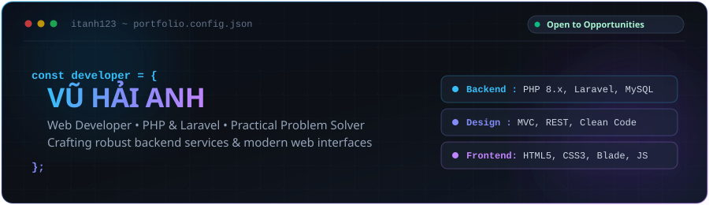

<!--
=============================================================================
  PORTFOLIO PROFILE README - itanh123
  Theme: Modern Dark Developer Aesthetic (GitHub Native Dark, Cyan & Purple)
  Developer: Vu Hai Anh (@itanh123)
=============================================================================
-->

  <!-- HERO BANNER -->
  

   
   

  <!-- QUICK INTRO BADGES -->
  

    
    
    
    
    
  

  <!-- QUICK TAGLINE -->
  

    <strong>Web Developer</strong> focusing on robust backend development with <strong>PHP &amp; Laravel</strong>, clean database architecture with <strong>MySQL</strong>, and responsive user experiences with <strong>Blade &amp; modern web standards</strong>.
  

  <!-- DIRECT ACTION BUTTONS -->
  

    
    
    
    
  

---

### 👨‍💻 About Me

Hello! I am **Vũ Hải Anh**, an enthusiastic web developer with a strong foundation in building web applications and backend systems. I enjoy creating practical, user-centered digital products—from database modeling and MVC architecture to frontend layout integration.

- 🎯 **Core Focus**: Developing structured web applications using **PHP**, **Laravel**, and relational databases (**MySQL/PDO**).
- 🧩 **Engineering Mindset**: Dedicated to clean code structure, modular architecture, and practical problem-solving.
- 🎨 **User Interface**: Integrating responsive web layouts with **HTML5, CSS3, JavaScript, Bootstrap 5**, and Laravel's **Blade** templating engine.
- 🔄 **Continuous Growth**: Actively expanding my engineering toolkit, refining software design patterns, and staying up to date with modern web best practices.

---

### 🛠️ Tech Stack

Technologies and tools I actively work with across my repositories and projects:

#### Backend & Databases

  
  
  
  
  

#### Frontend & Templating

  
  
  
  
  

#### Development Tools & Ecosystem

  
  
  
  
  

---

### 🚀 Featured Projects

A curated selection of my strongest public repositories demonstrating practical implementation skills:

<table>
  <thead>
    <tr>
      <th width="35%">Project &amp; Repository</th>
      <th width="40%">Description &amp; Key Features</th>
      <th width="25%">Technologies</th>
    </tr>
  </thead>
  <tbody>
    <!-- Project 1: DATN Beverage Ordering Platform -->
    <tr>
      <td>
        <a href="https://github.com/itanh123/DATN-DATDOUONG-COZYHNA">
          <strong>🍹 COZYHNA Beverage Ordering System</strong>
        </a>
         
        <em>Graduation Project (DATN)</em>
      </td>
      <td>
        Full-stack beverage ordering web platform featuring product catalog, cart management, user order workflows, automated PDF invoice generation, and OAuth integration.
      </td>
      <td>
        <code>Laravel</code> <code>PHP 8.3</code> <code>Blade</code> <code>MySQL</code> <code>DomPDF</code> <code>Socialite</code> <code>Vite</code>
      </td>
    </tr>
    <!-- Project 2: Duan1 Booking System -->
    <tr>
      <td>
        <a href="https://github.com/itanh123/Duan1">
          <strong>📅 Booking &amp; Appointment Manager</strong>
        </a>
         
        <em>Dự án 1 (Capstone Project)</em>
      </td>
      <td>
        End-to-end appointment scheduling application with client booking interface, schedule modification request handling, administrative dashboard, and automated cron routines.
      </td>
      <td>
        <code>PHP</code> <code>MySQL (PDO)</code> <code>MVC Pattern</code> <code>Bootstrap</code>
      </td>
    </tr>
    <!-- Project 3: duanmau E-Commerce -->
    <tr>
      <td>
        <a href="https://github.com/itanh123/duanmau">
          <strong>🛒 Modular E-Commerce Store</strong>
        </a>
         
        <em>Dự án mẫu (MVC Architecture)</em>
      </td>
      <td>
        Structured e-commerce web platform built with custom PHP MVC architecture, complete with catalog browsing, shopping cart workflows, admin management, and documented UML use case diagrams.
      </td>
      <td>
        <code>PHP</code> <code>MySQL</code> <code>MVC Architecture</code> <code>PlantUML / Mermaid</code>
      </td>
    </tr>
    <!-- Project 4: Digisky Landing Page -->
    <tr>
      <td>
        <a href="https://github.com/itanh123/digisky">
          <strong>🌐 DIGISKY Corporate Landing Page</strong>
        </a>
         
        <a href="https://itanh123.github.io/digisky/">
          <em>🔗 View Live Demo</em>
        </a>
      </td>
      <td>
        Responsive corporate landing page built for Bầu Trời Số DIGISKY with modern visual hierarchy, engaging typography, and optimized mobile performance.
      </td>
      <td>
        <code>HTML5</code> <code>CSS3</code> <code>JavaScript</code> <code>GitHub Pages</code>
      </td>
    </tr>
    <!-- Project 5: Interactive Portfolio & Quiz App -->
    <tr>
      <td>
        <a href="https://github.com/itanh123/info">
          <strong>⚡ Personal Portfolio &amp; Quiz UI</strong>
        </a>
         
        <a href="https://itanh123.github.io/info/">
          <em>🔗 View Live Demo</em>
        </a>
      </td>
      <td>
        Interactive web application showcasing modern card designs, dynamic typing animations, responsive layout systems, and a client-side quiz generator interface.
      </td>
      <td>
        <code>HTML5</code> <code>CSS3</code> <code>JavaScript</code> <code>Bootstrap 5</code>
      </td>
    </tr>
  </tbody>
</table>

---

### 📊 GitHub Activity & Insights

  <table border="0">
    <tr>
      <td width="50%" align="center">
        
      </td>
      <td width="50%" align="center">
        
      </td>
    </tr>
  </table>
  
<em>Data automatically updated based on public repository activity on GitHub.</em>

---

### 🎯 Current Focus & Growth

Here is what I am actively focusing on to elevate my engineering craftsmanship:

- 🐘 **Laravel Architecture**: Deepening expertise in service repositories, middleware pipelines, and RESTful API design.
- ⚡ **Database Efficiency**: Practicing query optimization, schema indexing, and relationship constraints with MySQL.
- 🧪 **Testing & Quality**: Incorporating automated unit testing workflows with PHPUnit and maintaining consistent code formatting.
- 🎨 **Modern Frontend UX**: Building clean, accessible, and responsive user interfaces that pair seamlessly with backend controllers.

---

### 📬 Connect & Collaborate

I am open to discussions on web development projects, junior/entry developer opportunities, and technical collaborations:

- 📧 **Email**: [haianh13102006@gmail.com](mailto:haianh13102006@gmail.com)
- 💬 **Zalo**: [0868729743](https://zalo.me/0868729743)
- 👤 **Facebook**: [facebook.com/haianh.vu.92317121](https://facebook.com/haianh.vu.92317121)
- 🌐 **Online Portfolio**: [itanh123.github.io/info](https://itanh123.github.io/info/)
- 📍 **GitHub**: [@itanh123](https://github.com/itanh123)

 

  Crafted with passion for clean code and modern design &bull; © 2026 Vũ Hải Anh (@itanh123)

